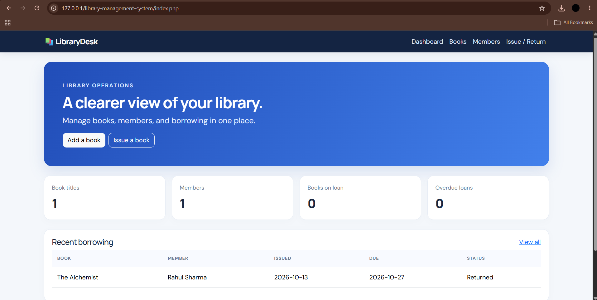
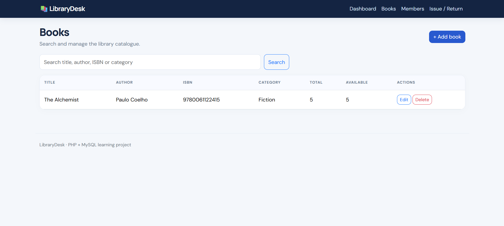
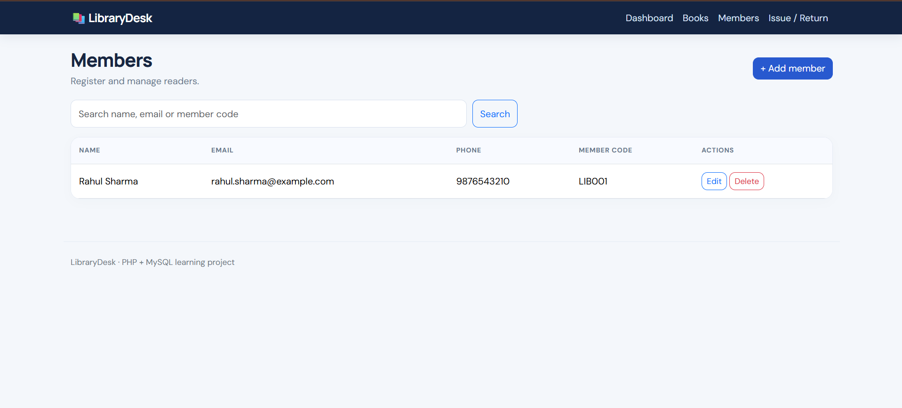
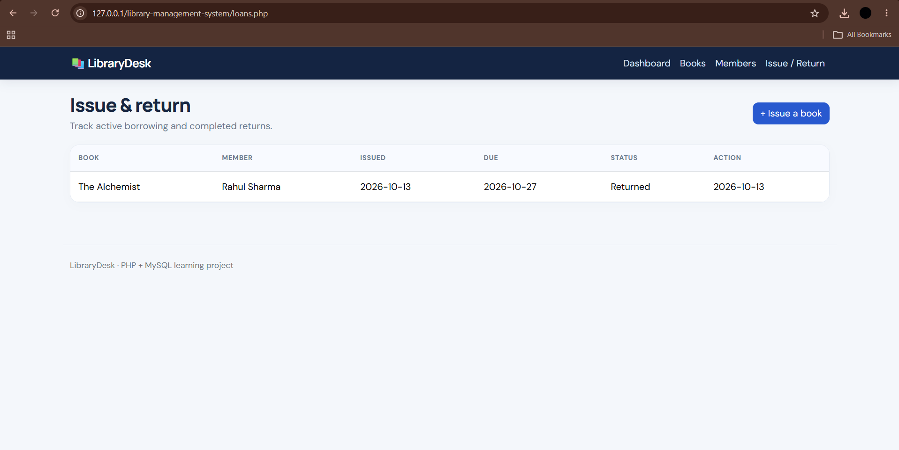

# Library Management System

A PHP and MySQL web application for managing a library catalogue, members, and borrowing. Built for local development with XAMPP.

## Features

- Dashboard with book, member, active-loan, and overdue-loan counts
- Book catalogue: add, search, edit, and delete books
- Member management: register, search, edit, and delete members
- Issue and return workflow with transactional availability updates
- Due dates and overdue indicators
- PDO prepared statements, output escaping, CSRF tokens, server-side validation, and hardened session cookie defaults
- Responsive Bootstrap interface

## Stack

PHP 8.1+, MySQL/MariaDB, PDO, HTML, CSS, Bootstrap 5, Apache/XAMPP.

## Setup (Windows)

1. Extract the folder to C:/xampp/htdocs/library-management-system/.
2. Start Apache and MySQL in XAMPP.
3. Open [phpMyAdmin](http://127.0.0.1/phpmyadmin/).
4. Import database/schema.sql using phpMyAdmin's Import tab.
5. Copy config.example.php to config.php.
6. Edit config.php with your local database host, port, database name, username, and password. The example uses port 3307 and database library_management; use 3306 if that is the port configured in your MySQL installation. The local config.php is ignored by Git.
7. Open [http://localhost/library-management-system/](http://localhost/library-management-system/).

## Security boundary

**The application currently has no authentication or role-based authorization.** Anyone who can reach the running application can view and modify its library records. Keep it on a local development machine; do not expose it to a LAN, public IP, or production server. CSRF protection and session cookie settings do not replace access control. Use fictional data only.

## First Test

1. Add a book with several copies.
2. Register a member.
3. Issue a copy and confirm available copies decrease.
4. Edit the book's total copy count and confirm the available count remains consistent with active loans.
5. Mark the loan returned and confirm available copies increase.

## Screenshots

### Dashboard

### Books Management

### Members Management

### Issue and Return

## Future Improvements

Add authentication and role-based permissions, automated integration tests, pagination, CSV export, and a deployment pipeline. This is a learning project, not production-ready software.

## License

MIT.
