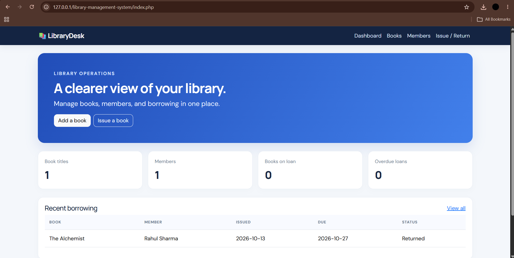
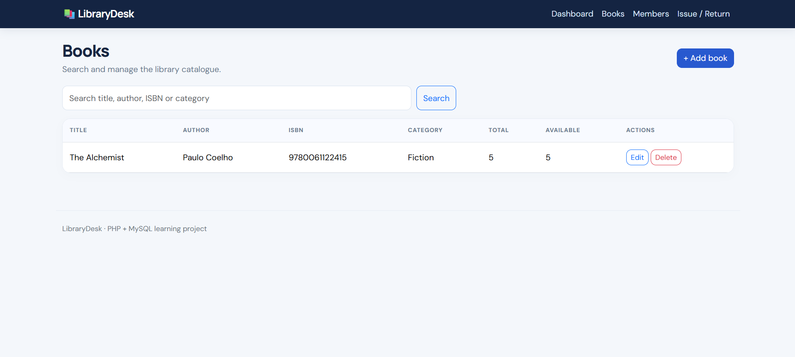
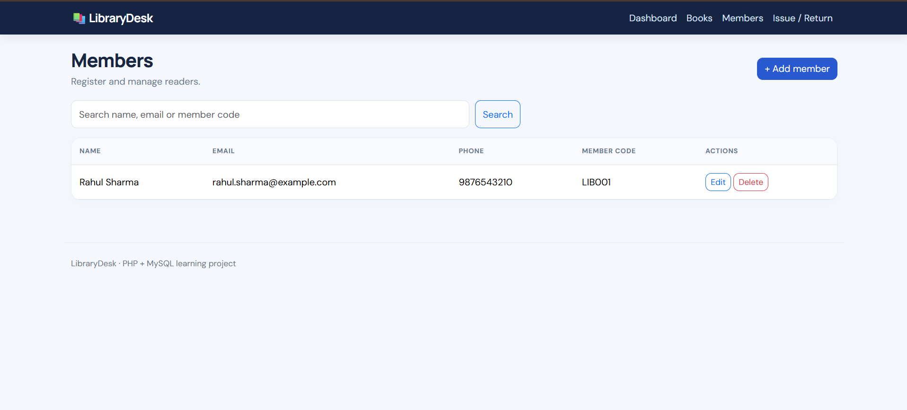
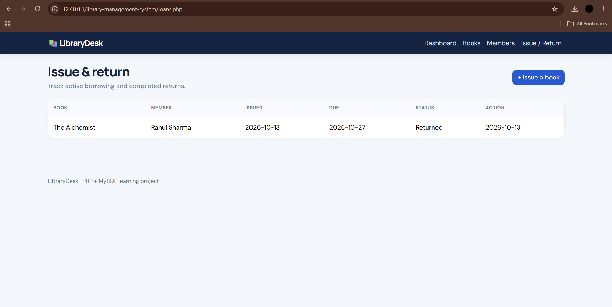

# Library Management System

A PHP and MySQL web application for managing a library catalogue, members, and borrowing. Built for local development with XAMPP.

## Features

- Dashboard: book titles, members, active loans, and overdue loans
- Book catalogue: add, search, edit, and delete books
- Member management: register, search, edit, and delete members
- Issue and return workflow that updates availability in a transaction
- Due dates and overdue indicators
- Prepared statements, output escaping, CSRF tokens, and server-side validation
- Responsive Bootstrap interface

## Stack

PHP 8+, MySQL/MariaDB, PDO, HTML, CSS, Bootstrap 5, Apache/XAMPP.

## Setup (Windows)

1. Extract the folder to `C:\xampp\htdocs\library-management-system\`.
2. Start Apache and MySQL in XAMPP.
3. Open [phpMyAdmin](http://127.0.0.1/phpmyadmin/).
4. Import `database/schema.sql` using phpMyAdmin's **Import** tab.
5. Check `config.php`. It is configured for `127.0.0.1:3307`, database `library_management`, user `root`, and a blank password. Change `DB_PORT` to `3306` if needed. Never use a blank root password on a public server.
6. Open [http://localhost/library-management-system/](http://localhost/library-management-system/).

## First Test

1. Add a book.
2. Register a member.
3. Issue the book and confirm available copies decrease.
4. Mark it returned and confirm available copies increase.

Use fictional data in screenshots and public repositories.

## Screenshots

### Dashboard

### Books Management

### Members Management

### Issue and Return

## Future Improvements

Add authentication and role-based permissions, automated tests, pagination, CSV export, Docker, and CI/CD. This is a learning project, not production-ready software.

## License

MIT.